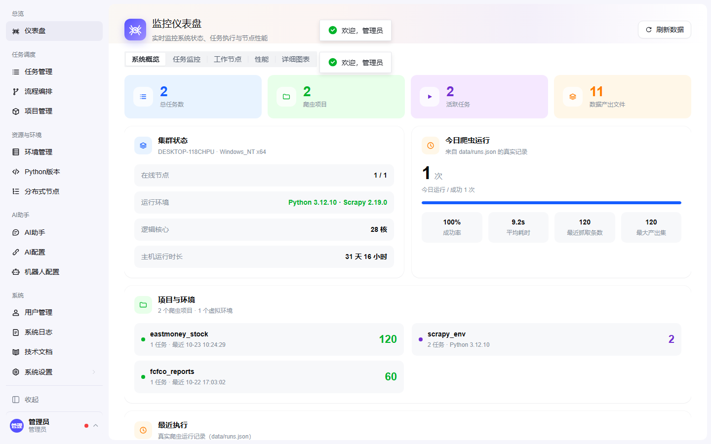
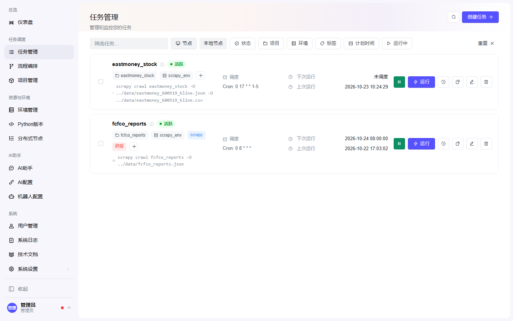
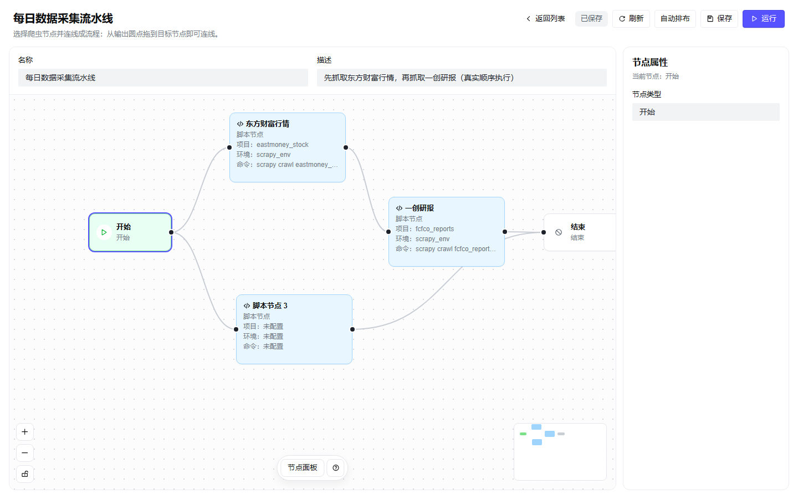
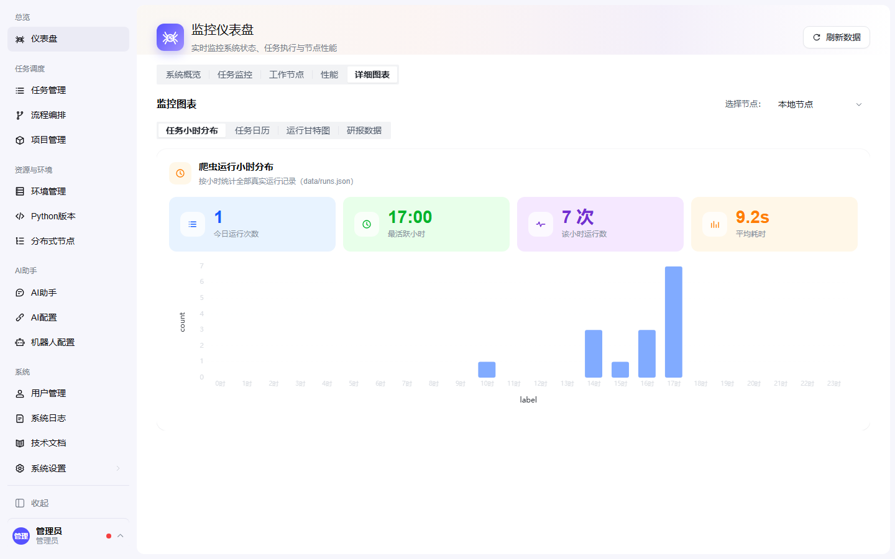
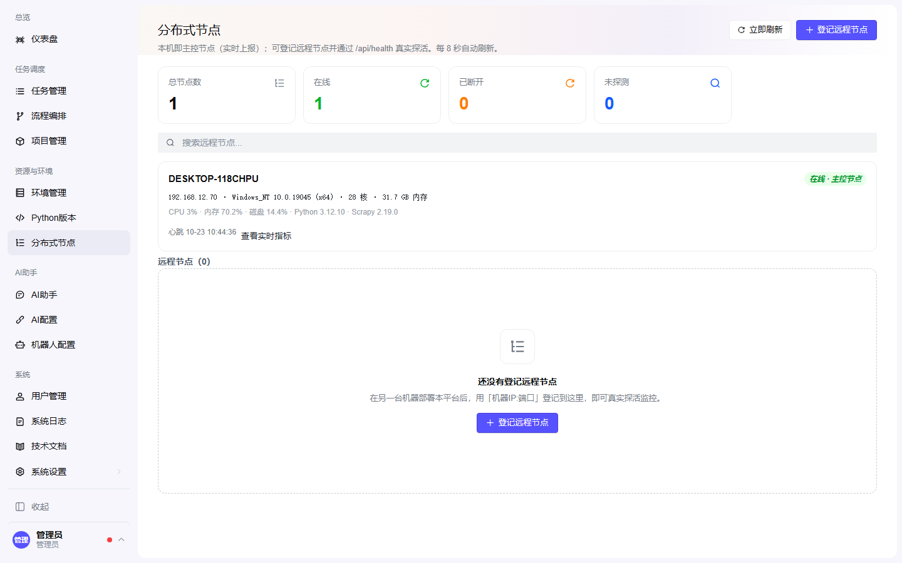
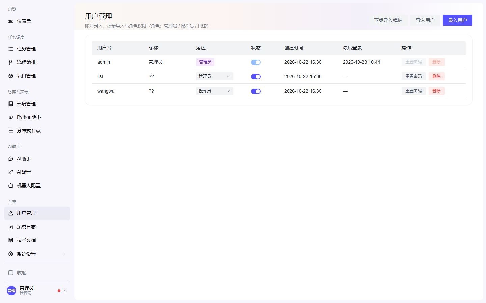
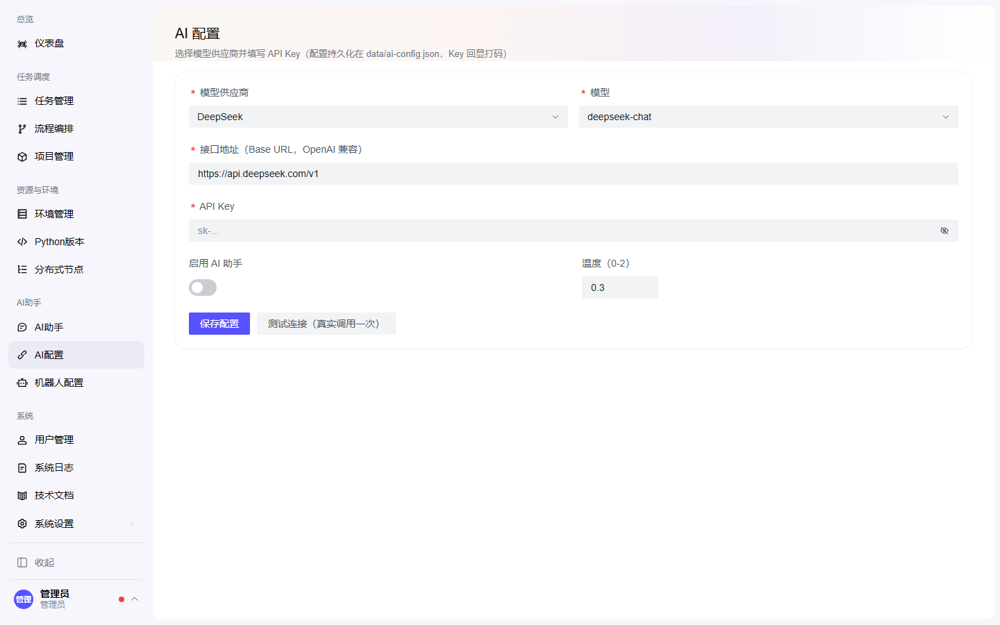

# ScrapyWeb 🕷️

**爬虫任务监控与编排平台** —— 在一个可视化界面里管理爬虫任务、编排执行流程、查看真实运行数据，并通过企业微信/飞书接收运行告警。

<p align="center">
  
</p>

## ✨ 功能特性

- **📊 真实数据仪表盘** —— KPI、集群状态、今日运行统计、项目/环境分布、最近执行，全部来自后端真实数据（无假数据）
- **任务管理** —— 爬虫任务的增删改查、标签自动配色、cron 表达式调度（内置调度器到点**自动运行**）、一键真实运行、运行历史
- **流程编排** —— 可视化画布：把真实爬虫按顺序连线成流程，拖拽/点选两种连线方式、失败即停、每步状态与耗时记录
- **告警推送** —— 企业微信 / 飞书 webhook 配置，爬虫与流程运行结果自动推送到群
- **AI 能力** —— 配置模型供应商与 API Key（DeepSeek / OpenAI / Kimi / 通义千问 / 自定义），AI 助手真实对话
- **节点与资源** —— 本机主控节点实时上报（CPU/内存/磁盘/心跳），远程节点登记与真实探活，Python 解释器检测，虚拟环境创建
- **用户体系** —— 注册 / 登录 / 角色权限（管理员 / 操作员 / 只读），用户录入与 CSV·JSON 批量导入

## 📸 界面预览

| 任务管理 | 流程编排 |
| --- | --- |
|  |  |

| 详细图表（真实行情） | 分布式节点 |
| --- | --- |
|  |  |

| 用户管理 | AI 配置 |
| --- | --- |
|  |  |

更多截图见 [`docs/images/`](docs/images/)（登录页、流程列表、研报数据等共 10 张）。

## 🚀 快速开始

```powershell
# 1. 前端依赖
npm install

# 2. 爬虫虚拟环境（Scrapy）
python -m venv .venv
.venv\Scripts\python -m pip install scrapy

# 3. 启动（前端 + 内嵌后端同进程，默认 5173，被占用自动 +1）
npm run dev
```

打开控制台输出的地址（如 `http://127.0.0.1:5174/`），使用内置管理员登录：

```
用户名：admin
密码：admin123
```

> 首次登录后请在「用户管理」中修改密码。

## 🧭 使用指南

| 模块 | 用法 |
| --- | --- |
| **任务管理** | 任务由爬虫自动生成；点「运行」真实执行（可在 data/runs.json 看历史）；cron 到点自动运行；支持标签、暂停/恢复 |
| **流程编排** | 「节点面板」选择爬虫创建节点 → 从输出圆点**拖到**目标节点连线（或点选）→「运行」按顺序真实执行，失败即停 |
| **详细图表** | 股价走势（东财日线）、任务小时分布、任务日历、运行甘特图、研报数据 |
| **告警机器人** | 「AI助手 → 机器人配置」添加企业微信/飞书 webhook →「测试」发真实消息 → 运行结果自动推送 |
| **AI 能力** | 「AI助手 → AI配置」选供应商、填 API Key →「测试连接」→ AI 助手真实对话 |
| **分布式节点** | 本机自动注册为主控节点；其他机器部署本平台后按 `IP:端口` 登记，即可真实探活 |
| **用户管理** | 录入 / CSV·JSON 批量导入 / 角色调整 / 停用启用 / 重置密码 |

## 🏗️ 架构

```
┌─────────────────────────────────────────────┐
│  Vite Dev Server（单进程）                    │
│                                             │
│  ┌──────────────┐      ┌─────────────────┐  │
│  │  React 前端   │ ───▶ │  /api/* 中间件   │  │
│  │  React+G2    │      │  (server/)      │  │
│  └──────────────┘      └────────┬────────┘  │
│                                 │ spawn      │
│                        ┌────────▼────────┐  │
│                        │ Scrapy 爬虫工程   │  │
│                        │ (.venv + scrapy) │  │
│                        └────────┬────────┘  │
└─────────────────────────────────┼───────────┘
                                  ▼
                     data/*.json（产出 + 平台数据）
```

- `src/` —— 前端（React 19 + Vite + Arco Design + AntV G2）
- `server/` —— 后端 API（Vite 中间件插件，真实逻辑：运行爬虫、系统指标、任务/流程/用户持久化）
- `crawlers/` —— Scrapy 工程（`eastmoney_stock`、`fcfco_reports`，详见 [crawlers/README.md](crawlers/README.md)）
- `data/` —— 运行时数据（爬虫产出 + 平台数据），详见站内「技术文档」

## 👥 角色权限

| 角色 | 权限 |
| --- | --- |
| 管理员 admin | 全部功能 + 用户管理（录入/导入/角色/停用/重置密码/删除） |
| 操作员 operator | 除用户管理外的全部功能 |
| 只读 readonly | 仅查看，写操作返回 403 |

## ❓ 常见问题

- **东方财富接口返回 0 条**：短时高频触发其 WAF 临时限流，等待几分钟后重跑即可
- **本机开启 Clash TUN**：后端已内置 DNS 钉扎（DoH 解析真实 IP + 端到端探测 + 自动换 IP），无需手工处理
- **页面异常**：右上角「刷新数据」或重启 `npm run dev`；渲染错误会显示错误面板而非白屏
- 更多见站内「**技术文档**」（`/docs`），或 [crawlers/README.md](crawlers/README.md)

## 🛠️ 开发脚本

```powershell
npm run dev                    # 开发（前端+后端）
npm run build                  # 类型检查 + 生产构建
node scripts/uitest.mjs        # Playwright 真实浏览器回归验证（登录/任务/流程/连线）
node scripts/docs-shots.mjs    # 重新生成 README 截图
```

## 🧰 技术栈

React 19 · TypeScript · Vite · Arco Design · AntV G2 · Scrapy 2.19 · Node.js（内嵌后端，零额外依赖）

---

蜘蛛 Logo 由本项目原创设计（八爪 + 雷达躯体 + 监控脉冲线），见 [src/icons.tsx](src/icons.tsx) 与 [public/favicon.svg](public/favicon.svg)。
